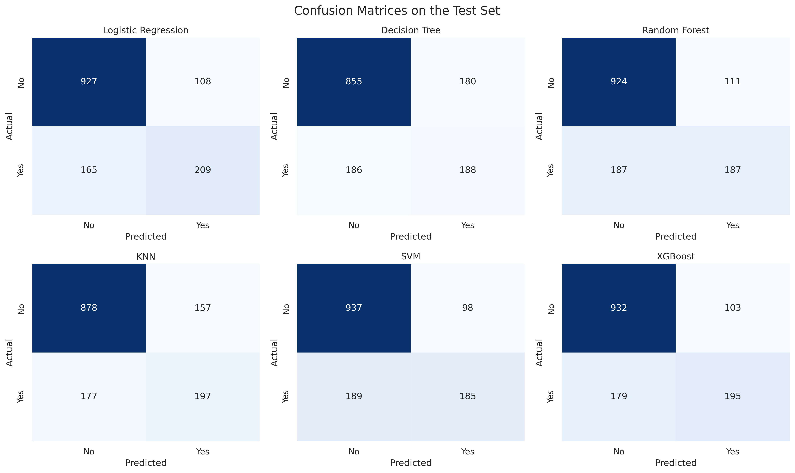
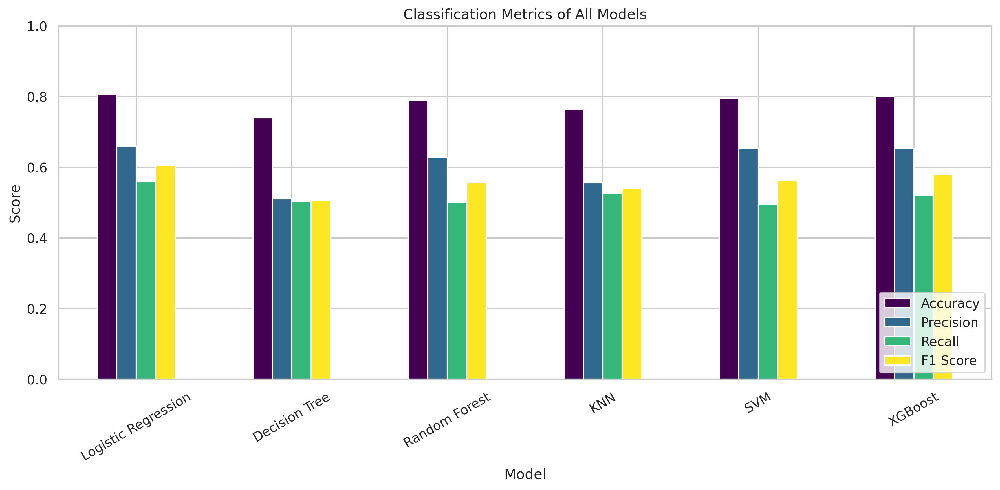
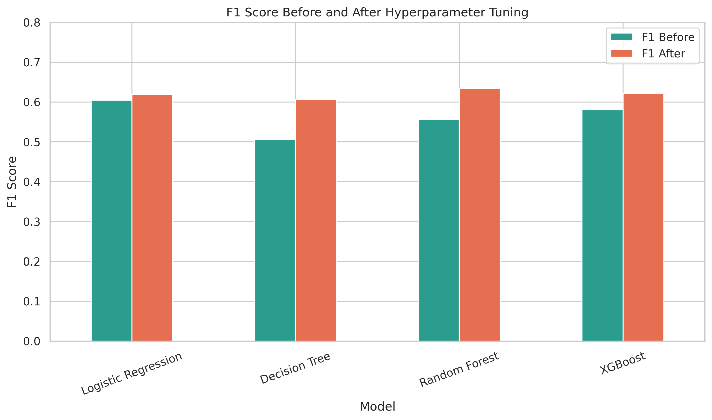
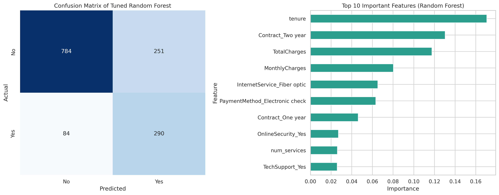

# Customer Churn Prediction: Building and Comparing Machine Learning Models

**Devixo Solutions | AI/ML Internship Program | Task 02: Build and Compare Machine Learning Models**

**Author:** Aman Khan  
**Internship Domain:** AI/ML

## Project Objective
To develop several machine learning models for a real-world prediction problem, evaluate them with suitable metrics, compare them, tune them with hyperparameter search and recommend the best model. The problem is to predict which telecom customers will **churn** (leave the company).

## Dataset Description
The Telco Customer Churn dataset contains 7,043 customers and 21 columns: demographics, the services each customer uses, contract and billing details, and the target column `Churn` (Yes/No). About 26.54% of the customers churned, so the classes are imbalanced.

## Dataset Source
Kaggle: [Telco Customer Churn](https://www.kaggle.com/datasets/blastchar/telco-customer-churn) by BlastChar (IBM sample data).

## Technologies Used
Python 3, Google Colab, Jupyter Notebook, GitHub

## Libraries Used
Pandas, NumPy, Matplotlib, Seaborn, Scikit-learn, XGBoost

## Project Workflow
Data Loading → Data Preprocessing → Model Development → Model Evaluation → Model Comparison → Hyperparameter Tuning → Conclusion

**Preprocessing:** fixed the hidden missing values in `TotalCharges` (11 new customers with tenure 0), checked duplicates (none), dropped `customerID`, created two features (`num_services`, `is_auto_pay`), encoded categorical columns, split the data 80/20 (stratified) and scaled numerical features after the split to avoid data leakage.

**Models:** Logistic Regression, Decision Tree, Random Forest, KNN, SVM and XGBoost for classification. As an extra regression task (to cover MAE, MSE, RMSE and R²), `MonthlyCharges` was predicted with Linear Regression, Decision Tree, Random Forest and XGBoost.

**Metrics:** Accuracy, Precision, Recall, F1 Score, ROC-AUC, Confusion Matrix, MAE, MSE, RMSE, R² and training time.

## Results

### Classification (default settings, test set)
| Model | Accuracy | Precision | Recall | F1 Score | ROC-AUC |
|---|---|---|---|---|---|
| Logistic Regression | 0.8062 | 0.6593 | 0.5588 | 0.6049 | 0.8422 |
| XGBoost | 0.7999 | 0.6544 | 0.5214 | 0.5804 | 0.8442 |
| SVM | 0.7963 | 0.6537 | 0.4947 | 0.5632 | 0.7955 |
| Random Forest | 0.7885 | 0.6275 | 0.5000 | 0.5565 | 0.8217 |
| KNN | 0.7630 | 0.5565 | 0.5267 | 0.5412 | 0.7783 |
| Decision Tree | 0.7402 | 0.5109 | 0.5027 | 0.5067 | 0.6641 |

### After hyperparameter tuning (GridSearchCV / RandomizedSearchCV, 5-fold CV, F1)
| Model | F1 Before | F1 After | Recall Before | Recall After |
|---|---|---|---|---|
| Random Forest | 0.5565 | **0.6339** | 0.5000 | 0.7754 |
| XGBoost | 0.5804 | 0.6218 | 0.5214 | 0.7914 |
| Logistic Regression | 0.6049 | 0.6188 | 0.5588 | 0.7834 |
| Decision Tree | 0.5067 | 0.6067 | 0.5027 | 0.7941 |

### Regression (predicting MonthlyCharges)
| Model | MAE | RMSE | R² |
|---|---|---|---|
| Linear Regression | 0.7893 | 1.0513 | 0.9988 |
| XGBoost | 0.8193 | 1.0944 | 0.9987 |
| Random Forest | 0.8966 | 1.1921 | 0.9984 |
| Decision Tree | 0.9436 | 1.3069 | 0.9981 |

## Major Findings
- With default settings Logistic Regression was the best classifier (F1 0.6049), while the Decision Tree and Random Forest overfitted (99.8% training accuracy).
- Accuracy was misleading: every default model found only about half of the churners (recall 49% to 56%).
- Tuning improved all models. The **tuned Random Forest is the recommended model**: highest F1 (0.6339), recall 77.54% and ROC-AUC 0.8424. The price is lower precision (53.60%) and accuracy (76.22%).
- The most important features are tenure, a two-year contract and total charges. Month-to-month customers churn at 42.71% against 2.83% for two-year contracts, and customers in their first year churn at 47.44%.
- For regression, Linear Regression was the best, because the monthly bill is almost an additive sum of fixed service prices.

## Screenshots
| Confusion matrices | Metrics comparison |
|---|---|
|  |  |

| F1 before and after tuning | Best model analysis |
|---|---|
|  |  |

## Project Structure
```
Task_02_AI_ML/
├── dataset/        telco_churn.csv
├── notebook/       Task_02_ML_Models.ipynb
├── images/         charts and comparison tables
├── requirements.txt
└── README.md
```

## How to Run the Project
1. Clone the repository:
   ```
   git clone https://github.com/Amankhan987/Task_02_AI-ML_Customer_Churn_Prediction.git
   cd Task_02_AI-ML_Customer_Churn_Prediction
   ```
2. Install the libraries:
   ```
   pip install -r requirements.txt
   ```
3. Open `notebook/Task_02_ML_Models.ipynb` in Jupyter Notebook or Google Colab.
4. In the notebook, change the dataset path in Section 1.2 to your location, for example `PATH = '../dataset/telco_churn.csv'` for local use, and set the `IMG` folder in Section 3.0 to `'../images/'`. Remove the Google Drive mounting cell if you run it locally.
5. Run all cells from top to bottom.

## Author
**Aman Khan** | AI/ML Intern, Devixo Solutions
